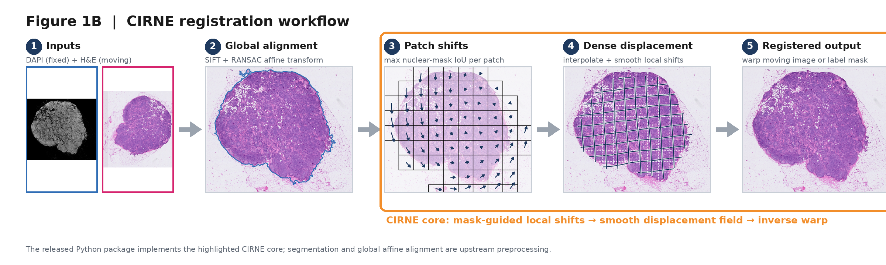

# CIRNE

**CIRNE** is a lightweight, instance-mask-guided nonrigid registration tool for
spatial imaging. It estimates local translations from foreground masks, builds
a smooth deformation field, and warps the original instance-label image while
preserving label IDs.

## Method overview



**Figure 1B. CIRNE registration workflow.** DAPI and H&E are first brought into
global alignment using an upstream affine-registration step. CIRNE then
estimates patch-wise translations by maximizing nuclear-mask IoU, interpolates
and smooths these sparse shifts into a dense displacement field, and applies an
inverse warp to the moving image or instance-label mask. The released Python
package implements the highlighted CIRNE core (steps 3–5); image segmentation
and global affine alignment are upstream preprocessing and are not installed as
part of `cirne`.

## How it works

1. Divide the moving and fixed masks into spatial patches.
2. Estimate each eligible patch's integer translation by FFT correlation and
   local IoU refinement.
3. Interpolate the patch translations into a smooth displacement field.
4. Inverse-warp the original moving labels with nearest-neighbour sampling so
   instance IDs are retained.

CIRNE estimates geometry from binary foreground occupancy; it does not perform
one-to-one matching between cell IDs in the two images.

## Installation

```bash
git clone https://github.com/Xingyuan-Zhang/CIRNE.git
cd CIRNE
python -m pip install .
```

For development and tests:

```bash
python -m pip install -e '.[test]'
pytest
```

## Quick start

Both inputs must be 2-D instance-label images of equal shape. Background is
zero; positive integers are instance IDs. NPY and TIFF are supported.

```bash
cirne-register \
  --moving moving_cells.tif \
  --fixed fixed_nuclei.npy \
  --output cirne_results \
  --patch-size 500 \
  --stride 500
```

The command writes:

- `warped_labels.npy`: registered instance labels;
- `patch_moves.npz`: patch centres, translations, and local IoU scores;
- `coarse_field.npz`: smooth coarse displacement field;
- `summary.json`: parameters and before/after overlap metrics.

The Python API exposes the same workflow:

```python
from cirne import register_masks, warp_labels

result = register_masks(moving_labels, fixed_labels, patch_size=(500, 500))
warped = warp_labels(
    moving_labels,
    result.dy_grid,
    result.dx_grid,
    result.grid_step,
)
```

See [`examples/synthetic_registration.py`](examples/synthetic_registration.py)
for a complete runnable example.

## Parameter guidance

- `patch-size`: should contain enough foreground structure to determine a
  unique translation. Start with 500 pixels for the original workflow.
- `stride`: use the patch size for non-overlapping estimation; decrease it for
  denser estimates at higher compute cost.
- `refine-radius`: local IoU search radius around the correlation estimate.
- `grid-step`: spacing of the coarse deformation grid. Smaller values produce
  a denser field but use more memory.
- `smooth-sigma`: Gaussian smoothing on the coarse grid.

## Package scope

The installable `cirne` package contains only the model-free CIRNE registration
algorithm, label-image I/O, and command-line interface. It does not depend on
Cellpose, PyTorch, or any segmentation-model weights.

Segmentation-model training is not part of CIRNE. For research reproducibility,
the associated CellposeSAM training scripts are archived separately under
[`downstream_analysis/model_training`](downstream_analysis/model_training) and
are excluded from the Python package and its dependencies.

## Reproducibility and downstream analysis

The correspondence between the original research workspace and this public
repository is documented in
[`downstream_analysis/PROVENANCE.md`](downstream_analysis/PROVENANCE.md). Large
raw images, intermediate arrays, and model checkpoints are excluded.

## Citation

If CIRNE contributes to your work, please cite this repository and the Halo
paper:

> Zhang X, Zhuang H, Ji Z. Halo: a pretrained model for whole-cell segmentation
> from nuclei images in spatial transcriptomics. *Briefings in Bioinformatics*.
> 2026;27(5):bbag515. doi:10.1093/bib/bbag515.

## License

MIT License. See [`LICENSE`](LICENSE).
